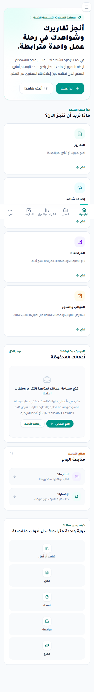
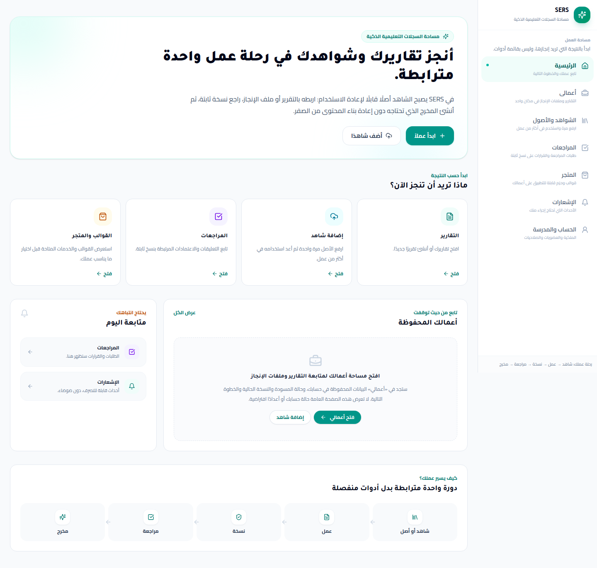

# SERS — نتيجة تنفيذ المرحلة الأولى: سد فجوات الأساس

**تاريخ التنفيذ:** 18–19 نوفمبر 2026.
**المستودع:** `anas8273/sers-preview`.
**خط الأساس:** `e666157a988f10efd6dcae5e808526ae32985945`، آخر دمج PR39.
**فرع المراجعة الفعلي:** `fix/foundation-gate-20261118-code-review`، كمسودة دون تحديثات workflows المقيدة.

> **عائق التسليم النهائي:** GitHub رفض تحديث ملفات CI لغياب صلاحية workflows. الشفرة تُرفع في PR مسودة، وتحديثات CI تُسلّم في patch منفصل. لا يُدمج PR ولا تُسمى CI ناجحة قبل تطبيقه وإعادة الفحص. تفاصيل [تسليم GitHub](GITHUB-HANDOFF.md).

## الحكم المختصر

نُفذت حزمة إصلاح الأساس في مساحة تطوير منفصلة، لا في الموقع المنشور. نجحت فحوص TypeScript والبناء، ومجموعة الاختبارات المعزولة، ومجموعة منتقاة من تكامل MySQL 8.4 الحقيقي، ورحلات متصفح اصطناعية مترابطة. لم تُعدّل قاعدة مُدارة أو بيانات مدرسة، ولم يُدمج شيء في `main` الأصلي، ولم يُنشر الموقع.

الحزمة **قابلة للمراجعة وقبول staging ببيانات اصطناعية ضمن المسارات المختبرة**؛ ليست موافقة على إطلاق عام. إعادة تصميم جميع الأدوات، وترحيلها إلى النواة، وكل ميزات المنافسين لم تُنفذ في هذه المرحلة. التحليل السابق للمنافسين وخطة الميزات يظلان خط الأساس للدفعات التالية، لا قائمة ميزات مكتملة اليوم.

## 1. الإصلاحات المنفذة

### أ. HTTP والقبول قبل العمل المكلف

أُزيل parsing عام يصل إلى 50MB. أصبحت الحدود العامة محدودة: JSON حتى 256,000 بايت وform حتى 64,000 بايت. مسارات PDF وDOCX تستعمل admission خاصًا، ثم المصادقة وrate limit، ثم parser محدودًا بـ3,000,000 و16,000,000 بايت على الترتيب. حافظت مسارات AI على عقدها المحدود المنفصل.

يرفض admission الطول المعلن الكبير مبكرًا، ونوع المحتوى غير المقبول، والضغط، وContent-Length غير الصحيح. الطلب chunked يُحد أثناء قراءة الدفق قبل الوصول إلى handler؛ **لا يعني ذلك أن حجمه الكامل يُعرف قبل كل كلفة مصادقة**. أُصلح اختلاف `/api/export-pdf/` وحالة أحرف المسار، مع منع استثناء مسار غير متعلق مثل `/api/trpcevil` من parser العام. بقيت المصادقة والعزل والتعامل المحايد مع الخطأ قائمة.

الملفات الأساسية: `server/_core/http-body-admission.ts` و`server/_core/index.ts`، مع اختبارات HTTP فعلية لترتيب الوصول والحدود والمسار المكافئ.

### ب. الاختبارات العامة ومنع التسليم المكرر

أُضيف التحقق الخادمي من الأسئلة والإجابات، وحدود العدد والطول والبايتات، ورفض مفاتيح إجابات غير معروفة، والتحقق من هوية الطالب المدخلة، وrate limiter مرتبط بالاختبار والعنوان. `view` لا يكشف `correctAnswer` أو `correctIndex`.

أُضيف `attemptId` وقيد فريد لكل اختبار ومعرف محاولة. أثبت MySQL أن 20 تسليمًا متزامنًا بالمعرف نفسه تنتج صفًا واحدًا، وأن إعادة استخدامه لطالب أو إجابات مختلفة تُرفض كتعارض. الواجهة تحفظ **معرفًا عشوائيًا فقط** في sessionStorage؛ لا تحفظ اسم الطالب أو هويته أو الإجابات في هذا المسار. إن مُنع sessionStorage يبقى المعرف ثابتًا خلال عمر الصفحة المفتوحة، وليس بعد إعادة تحميلها.

أصبحت نتائج المعلم بالصفحات. الواجهة تطلب صفحات صريحة وتعرض السابق والتالي، والاستدعاء القديم بلا pagination لا يُسقط الصفوف بعد الخمسين بصمت؛ يرفض مع رسالة انتقال واضحة عند وجود نتائج إضافية. اختبار أكثر من 50 تسليمًا أثبت ظهور كل الصفوف دون تكرار بين الصفحات.

**حدود مهمة:** العملاء القدماء الذين لا يرسلون nonce ما زالوا يُقبلون وفق توافق معلن، ولا ينطبق عليهم منع التكرار نفسه. المعرف العشوائي ليس هوية طالب موثقة ولا قاعدة «محاولة واحدة لكل طالب». سياسة المحاولات، الاحتفاظ، وإغلاق التصحيح المقالي واعتماد نتيجته ما زالت قرارات WF-004 اللاحقة.

### ج. الاعتماديات والبناء

وُحد pnpm على `10.18.1`، وNode على السلسلة 22 بحد أدنى `22.12.0`. حُفظ lockfile وpatch الحالي، واستُخدمت سياسة lifecycle المدعومة دون حذف القفل أو وضع Zod 3→4 override غير مثبت.

رُقّي Puppeteer إلى `25.18.1` عبر release upstream: أزيل `extract-zip` من الشجرة، وأصبحت Chromium BiDi تستعمل Zod `4.6.7` المعلن في اعتمادية upstream. أُصلح توافق `setContent` مع Puppeteer 25 مع بقاء انتظار الخطوط والشبكة المحدود. نجح تشغيل المتصفح وإنشاء PDF فعلي وإغلاقه.

نتيجة فحص **اعتماديات الإنتاج**: `critical=0`, `high=0`, `moderate=0`, `low=2`. تنبيها low الباقيان من KaTeX موثقان؛ لا نعتبرهما exploit مثبتًا، ولا نعتبر غياب high إثباتًا على خلو التطبيق من الثغرات. الأمر الخام `pnpm audit --prod --json` يرجع exit=1 بسبب low، بينما بوابة CI المعلنة تحجب critical/high فقط. لا يوجد تجاهل صامت لهذه التنبيهات.

### د. عقد تقرير واحد ونسخ لا يعاد تفسيرها بصمت

أُضيفت projection/schema مشتركة بين المحرر والمعاينة وHTML/PDF وWord الأصلي القابل للتحرير والإسقاط العام الآمن. حافظت الحقول typed، مثل تاريخ الورشة وعدد المشاركين والمواد، على معناها بدل سقوطها لأن قائمة العرض القديمة اقتصرت على سبعة حقول نصية.

انتقال schema v1 صريح. schema v2 يطلب descriptors مجمدة صالحة وغير فارغة؛ snapshot مكسور لا يسقط تلقائيًا إلى تعريف قالب runtime أحدث. السجل التاريخي لا يعاد تفسيره بقالب حالي بصمت.

الإسقاط العام لا يعيد snapshot الخام، ولا storageKey أو URL الأصل أو token أو metadata الملكية. parity هنا للحقول الآمنة؛ عرض صور الأصول الخاصة بالرابط العام ليس ترخيصًا تلقائيًا لنشرها، وتبقى سياسة نشر الصور منفصلة.

### هـ. شاهد مجمد بدل صورة أصل قابلة للتبديل

الصور المختارة في مسار WorkVersion لا تستعمل fallback إلى `asset.preview` الخام. الصورة تتطلب تمثيلًا frozen محدودًا وهوية مصدر تشمل referenceVersion وdigest وbytes وcontentType وsourceAssetId وsourceUploadIntentId. مسار إنشاء النسخة يرتبط بأصل ready ومملوك ومتحقق منه، لا URL يختاره العميل.

الاختبارات ترفض الصورة المختارة غير المجمدة، وبيانات التجميد غير الصالحة والصور الفاسدة، وتحافظ على اختيار label-only المتعمد. renderer يستعمل preview المجمد لا صورة الأصل الحية؛ تبقى بوابة الملكية وسياسة الإلغاء والاحتفاظ منفصلتين عن ثبات محتوى النسخة. نجاح العقد والاختبارات الاصطناعية لا يثبت مزود التخزين والفاحص الخارجيين.

### و. تحذير النسخة القديمة قبل الإخراج والمشاركة

أصبحت `reviewSupport.versions` تعيد `reportRevision` المستخرج من snapshot على الخادم، دون إرسال snapshot أو أصوله. المقارنة رقمية، وليست مقارنة تواريخ. أثبت MySQL أن تعديل المسودة يزيد مراجعتها بينما مراجعة النسخة القديمة تبقى ثابتة.

إذا كانت المسودة أحدث، أو تعذر التحقق من المراجعة، يُحجب إنشاء PDF/Word أو المشاركة افتراضيًا. يسمح النظام بالاستمرار فقط بعد اختيار «متابعة النسخة القديمة على أي حال». يُعاد ضبط الاختيار عند تغير النسخة أو الصيغة أو مراجعة المسودة. لا تُكتب النسخة المعتمدة فوق محتوى جديد.

أثبتت رحلة المتصفح حالة المسودة الأحدث، وتعطيل الزر أولًا، والاختيار الصريح، ثم إخراج PDF وWord ومشاركة QR محمي من **محتوى النسخة التي راجعها المعلم** لا من المسودة اللاحقة.

### ز. المشاركة والسجل والعزل

وُحدت التركيبات المسموحة لنوع Output وسياسة ظهوره مع resolver. تُرفض التركيبات غير المدعومة قبل الحفظ. Word قابل للتحرير خاص؛ المشاركة بالرابط/QR ليست تحويلًا لأصل خاص إلى رابط خام. create/revoke مسجلان في عقد التدقيق الملائم مع metadata محدودة، ولا يكشف تنزيل خاص أصل التخزين ولا يوسع عضوية المدرسة.

أثبتت اختبارات المخرجات الخاصة والإلغاء أن URL معروفًا لا يستمر بالعمل بعد الإبطال، وأن العضوية تُعاد قراءتها بعد انتظار القفل. اختيار نسخة قديمة بعد التنبيه لا يلغي شروط اعتماد النسخة وصلاحيات المستخدم.

### ح. تحسينات UX العربية الأساسية

حُسنت تسمية التنقل وaria-current وسلوك القائمة وEscape واستعادة التركيز. أصبح 404 عربيًا وRTL، وحالات المشاركة المتعطلة محايدة وبإعادة محاولة بدل spinner غير منتهٍ أو عرض ملكية صاحب الرابط.

ثُبت `/reports` كمدخل تقارير خادمي عبر WorkHub؛ مركز التقارير المحلي بقي على `/reports/legacy` بوصف انتقالي. أُزيلت مداخل الرفع القديمة المتوقفة من نموذجين بدل إبقائها كوعود قابلة للنقر. لا تعني هذه الخطوة ترحيل كل أداة قديمة.

أزيلت لغة «النواة الجديدة» والوعد بأن العمل يحتاج معلومة واحدة فقط. الصفحة العامة لا تختلق حسابًا فارغًا أو أعداد أعمال؛ توجه إلى «أعمالي» حيث البيانات الخادمية الفعلية. لوحة رئيسية شخصية شاملة وإعادة تصميم جميع المحررات تظلان دفعة UI/UX لاحقة.

### ط. هوية المسارات والإصدار

أُضيف مولد manifest من `App.tsx` واختبار تطابق المصدر. `GET /manus-routes.json` أعاد HTTP 200 وJSON صحيحًا مع **28 مسار صفحة**، بما فيها المسارات الديناميكية، دون APIs و404-only route. `repository-metadata.json` يوضح خط الأساس ووضع التطوير المعزول، ولا يزعم إثبات artifact المنشور أو SHA تشغيل حي.

## 2. نتائج القبول وحدودها

| طبقة الفحص | النتيجة الموثقة | ما لا تثبته |
|---|---|---|
| TypeScript | `pnpm check` ناجح | تشغيل مزودات خارجية |
| البناء | `pnpm build` ناجح؛ توجد تحذيرات chunk كبير | سرعة واجهة على أجهزة المعلمين أو نشر ناجح |
| الاختبارات المعزولة | 96 ملفًا ناجحًا؛ 925 اختبارًا ناجحًا؛ 155 متجاوزًا في 21 ملفًا | المتجاوز ليس ناجحًا؛ 4 ملفات legacy مستبعدة من مجموعة quality |
| آخر تعديل UX/manifest/privacy/guard | 4 ملفات، 16 اختبارًا ناجحًا | ليس إعادة تنفيذ المجموعة المعزولة كاملة بعد تعديل صياغة الرئيسية |
| MySQL 8.4.13 | 55 assertion ناجحة في 10 ملفات منتقاة، بتشغيل متسلسل | ليست كل اختبارات التكامل أو قاعدة إنتاج |
| المتصفح — التقرير | autosave ثم نسخة ومراجعة وPDF/Word وQR محمي وإلغاء، مع تنبيه stale، ناجح | مسح QR بكاميرا أو Word مكتبي أو UAT |
| المتصفح — الحساب | دعوة مدرسة، سنة أكاديمية وعمل عبر MySQL، ناجح | قبول مدرسي بأدوار حقيقية |
| المتصفح — OAuth | دخول وخروج وعزل حسابات ومنع cookie replay بعامل اصطناعي منفصل، ناجح | Manus OAuth/HTTPS الحقيقيان |
| متصفح المخرج العام | اختبار واجهة المخرج العام ناجح | اتفاق سياسة نشر صور الطلاب |
| الجوال والتنقل | 390 و1440 بلا overflow؛ فتح/إغلاق القائمة وEscape واستعادة التركيز ناجحة | ليس UAT شاملًا لكل المحررات |
| الاعتماديات | critical/high/moderate=0؛ low=2 | لا يعني خلو التطبيق من ثغرات منطقية |
| مراجعة مستقلة أخيرة | لا blocker إضافي مؤكد ضمن Phase1 المفحوصة | لا تمنح اعتماد إنتاج أو تدقيقًا شاملاً لكل المسارات |

كل MySQL استُخدم على `127.0.0.1:3307/sers_test` في مجلد خدمة منفصل. الحارس يرفض DSN مُدارًا أو إنتاجيًا حتى لو وُضع `NODE_ENV=test` أو `SERS_INTEGRATION=1`. لم نزوّر `GITHUB_ACTIONS`; أُضيف سماح محلي صريح للقاعدة المحددة فقط، مع التحقق من MySQL 8.4 حيث يشترطه الاختبار.

بعض المحاولات الأولى فشلت عند افتراض «CI فقط»، ثم صُحح حارس الاختبار. وفشلا مراقبة الأقفال كانا نتيجة تشغيل performance_schema=OFF في خادم الاختبار؛ شُغل ON ثم نجحت الاختبارات الأصلية دون إزالة assertion انتظار القفل. توقفت رحلة التصدير القديمة لأن الزر أصبح محجوبًا بسبب stale؛ عُدل الاختبار ليثبت التنبيه والاختيار الصريح لا ليتجاوز الحارس. السجلات الأولية محفوظة بوصفها محاولات تاريخية، ولا تُخلط بالنتيجة الأخيرة.

لا نجمع 925 و55 و16 في رقم «اختبارات فريدة»؛ توجد تغطية متكررة بين الطبقات. نجاح السكربت الجامع نفسه ليس معيار نجاح؛ الحكم من نتائج الأوامر والاختبارات المفردة.

## 3. ما لم أفعله

لم أنشر الموقع، ولم أغير main الأصلي أو branch protection، ولم أدمج PR40 أو أفترض صحة جميع تحسيناته، ولم أختبر بيانات إنتاج، ولم أستبدل جلسات الموقع بهوية اصطناعية. الهوية الاصطناعية محصورة في test harness لا يُستورد من التطبيق. لم أوسع الوظائف legacy أو أعد كتابة autosave والعزل المكتملين من الصفر.

الـcheckpoint الخاص بمساحة `sersfix` ليس تحديثًا للرابط المنشور القديم، ورفع فرع GitHub/PR ليس دمجًا أو نشرًا. نتائج CI الخارجية لا تُسمى ناجحة قبل ظهورها فعليًا.

## 4. ما يبقى قبل الإطلاق

1. OAuth وHTTPS وproxy/cookies الفعلية، والقبول والحدود الموزعة تحت أكثر من instance.
2. مزود تخزين وفاحص ملفات حقيقيان، وretention/cleanup واستجابة الإلغاء، وموقع البيانات والأساس النظامي لمعالجة بيانات الطلاب.
3. restore خارج المضيف وRTO/RPO لخدمة كاملة لا checksum fixture فقط.
4. فتح DOCX وتعديله في Microsoft Word الفعلي، وطباعة عربية ومراجعة فواصل الصفحات ومسح QR بأجهزة فعلية.
5. UAT بأدوار معلم ومراجع ومدير مدرسة، وإثبات أصول المعايير الرسمية وتحديثها.
6. معالجة تنبيهات KaTeX low وخطة أحجام JavaScript؛ وترحيل portfolio والتقارير القديمة والتحليلات والخطط إلى Work أو وسمها صراحة كأدوات شخصية.
7. حسم سياسة محاولات الاختبار واعتماد الأسئلة المقالية وربط تقاريرها بسجل المدرسة.

## 5. ترتيب الدفعات التالية وفق التحليل والمنافسين

**الدفعة التالية مباشرة:** مراجعة هذا PR ونتائج CI، وإغلاق أي تعارض مع PR40 على فرع اختبار قبل الدمج. لا نبدأ نسخ ميزات المنافسين فوق أساس غير مقبول.

**ثم UI/UX كاملة:** نظام تصميم عربي وRTL موحد، نماذج قوالب report typed، خطوات قصيرة مع حفظ واضح ومعاينة مطابقة، لوحة شخصية فعلية، حالات تحميل/خطأ/لا بيانات مميزة، ورحلة موحدة للمعلّم والمراجع دون إخراج local-only بوصفه سجلًا مؤسسيًا.

**ثم فجوات المنافسة:** نعود إلى مصفوفة بحث المنافسين المؤرخة 18 نوفمبر وننفذ دفعات مستقلة: النماذج التعليمية والشواهد وربطها بمعايير رسمية ذات إصدار؛ التحضير والخطط والاختبارات والتحليل؛ حزم القوالب والتقارير وملف الإنجاز؛ ثم التميز بترابط الأصل الواحد، والنسخة التي لا تتغير، والمراجعة والإبطال والعزل. كل دفعة لها عقد بيانات وقبول، لا مجرد زر جديد أو صفحة تسويقية.

الأولوية ليست إضافة كل شيء مرة واحدة أو الادعاء أننا الأفضل بلا قياس؛ الأولوية أن ما نقدمه للمعلم يعمل مترابطًا، ويحافظ على بياناته، ويطابق المستند النهائي الذي وافق عليه.

## مراجع التنفيذ داخل المستودع

- [HTTP والقبول](http-security.md)
- [تسليم الاختبار](exam-submission.md)
- [اعتماديات المتصفح ومصادر upstream](dependencies.md)
- [سلامة التقرير والنسخ](report-integrity.md)
- [المشاركة والتدقيق](sharing-audit.md)
- [العربية والتنقل](arabic-ux.md)
- [المراجعة المستقلة الأولى قبل التصحيح](independent-review.md)
- [المراجعة المستقلة الأخيرة](final-independent-review.md)
- [أصل الكود وحدود مساحة الاختبار](PROVENANCE.md)

## لقطات من النسخة المعدلة

## ملحق توافق Docker

وُحد pin Docker إلى pnpm 10.18.1، ونُسخت سياسة workspace قبل تثبيت القفل، وأُزيل `--ignore-scripts`. أصبح postinstall يستعمل CLI Puppeteer المقفل ويحترم `PUPPETEER_SKIP_DOWNLOAD` دون تعطيل lifecycle كلها. نجح اختباران موجهان لهذا العقد؛ لم يُبنَ Docker image ولم يُنشر شيء. تحديثات CI نفسها ليست في الفرع العام بسبب الصلاحية المذكورة.
